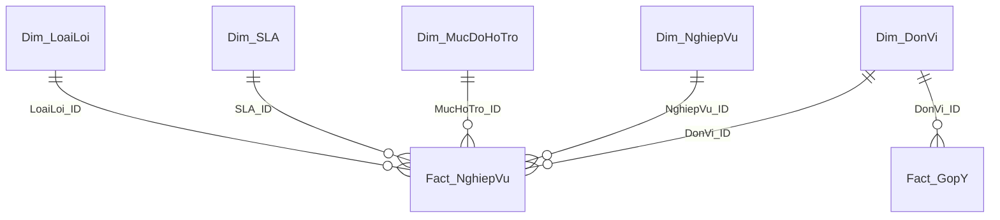

# HDBank eForm Data Processing

Python/Pandas pipeline that turns the raw Excel results of an eForm survey on **over-the-counter banking transactions** into a **star schema** (2 fact tables + 5 dimension tables), ready to be loaded into Power BI.

The raw survey is in a *wide* format: every business process repeats across several blocks of columns, and the open-ended feedback is spread over 22 more columns. This project converts it into a clean *long* format, classifies the responses, flags contradictory answers, and exports a data model for dashboarding.

## Pipeline

```
Excel (raw, wide)
   │  1. INGEST      read the workbook with Pandas, normalize column names
   ▼
Python / Pandas
   │  2. TRANSFORM   unpivot 47 business processes + TH1/TH2 feedback,
   │                 classify responses, flag contradictions
   ▼
   │  3. MODEL       split into Fact + Dim tables, self-check integrity, export CSV
   ▼
Power BI
   │  4. SERVE       relationships, DAX measures, dashboard
   ▼
   │  5. VALIDATE    reconcile Python ↔ Excel ↔ Power BI
```

## Repository structure

| File | Purpose |
|---|---|
| `buildstarschema.py` | **Main pipeline.** Raw Excel → 7 CSV tables in `star_schema/` |

The raw survey file is **not** included in this repository (internal bank data).

## Input data

One Excel file (`survey-dicore-giaodichtaiquay.xlsx`) with three kinds of columns:

| Group | Columns | Description |
|---|---|---|
| General information | 9 | `ID`, start/completion time, `Email`, `Language`, `Tên ĐVKD`, `Loại hình ĐVKD`, `Mã NV`, `Chức danh` |
| Business processes | 47 × 3 | Each of the 47 processes appears in 3 blocks of columns, in this order: **1) support level**, **2) processing time**, **3) error type** |
| Scenario feedback | 22 | Free-text answers `TH1.1`–`TH1.11` and `TH2.1`–`TH2.11` (two scenarios × 11 questions) |

The numeric suffix of repeated columns is not always regular (for example `12. Rút tiền mặt4`, `25. ...Nhập trả5`), so the pipeline matches the three blocks by **column order**, not by suffix.

## What the pipeline does

1. **Normalize column names**: removes line breaks, non-breaking spaces and extra whitespace.
2. **Unpivot business processes**: for each of the 47 processes, takes the 3 columns and stacks them into rows with `Muc_Do_Ho_Tro`, `Thoi_Gian_Xu_Ly`, `Loai_Loi`, plus the sort order `Thu_Tu_NV`.
3. **Flag contradictions** (`ĐVKD_Flag`): a row is flagged `Yes` when the support-level answer says the process has *not occurred yet* ("Chưa phát sinh nghiệp vụ…") but the processing time is not "Chưa phát sinh" or the error type is not "Không phát sinh lỗi". Otherwise `No`.
4. **Order SLA values** (`Thu_Tu_SLA`): `<5 phút` → 1, `>5 - 15 phút` → 2, `>15 - 30 phút` → 3, `>30 - 60 phút` → 4, `>60 phút` → 5, `Chưa phát sinh` → 6, missing → 99. Values not in the map are reported as warnings.
5. **Unpivot scenario feedback**: TH1 and TH2 become one row each per response; the 11 questions become columns `Q1_MoTaLoi` … `Q11_DeXuat`.
6. **Classify feedback**:
   - `Trang_Thai_TinhHuong` is derived from Q1 using keyword rules (veto keywords, "no issue" phrases, exact matches, residual-text length) and is either `Có phát sinh lỗi` or `Không phát sinh`.
   - `Co_The_Bo_Sot` is `True` when Q6, Q10 and Q11 combined still contain an error signal. It is computed **independently** of `Trang_Thai_TinhHuong`, so to count cases that were genuinely missed, filter `Trang_Thai_TinhHuong = "Không phát sinh"` as well. Empty answers are ignored (they never count as an error signal).
7. **Split into star schema**, assign surrogate keys, and run integrity checks.

## Output data model

Written to `star_schema/` (UTF-8 with BOM, comma-separated):

| Table | Grain / content | Key columns |
|---|---|---|
| `Fact_NghiepVu` | 1 response × 1 business process (rows = responses × 47) | `Response_ID`, `DonVi_ID`, `NghiepVu_ID`, `MucHoTro_ID`, `SLA_ID`, `LoaiLoi_ID`, `ĐVKD_Flag` |
| `Fact_GopY` | 1 response × 1 scenario (rows = responses × 2) | `Response_ID`, `DonVi_ID`, `Tinh_Huong`, `Q1…Q11`, `Trang_Thai_TinhHuong`, `Co_The_Bo_Sot` |
| `Dim_DonVi` | business unit | `DonVi_ID`, `Ma_DVKD`, `Ten_DVKD`, `Loai_Hinh_DVKD` |
| `Dim_NghiepVu` | business process | `NghiepVu_ID`, `Ten_Nghiep_Vu`, `Ten_Ngan`, `Nhom_Nghiep_Vu`, `Thu_Tu_NV` |
| `Dim_MucDoHoTro` | support level | `MucHoTro_ID`, `Muc_Do_Ho_Tro`, `Nhom_Ho_Tro`, `Thu_Tu_HoTro` |
| `Dim_SLA` | processing time | `SLA_ID`, `Thoi_Gian_Xu_Ly`, `Thu_Tu_SLA` |
| `Dim_LoaiLoi` | error type | `LoaiLoi_ID`, `Loai_Loi`, `Co_Loi`, `Thu_Tu_LoaiLoi` |

`Nhom_Ho_Tro` groups the support levels into the categories used by the KPIs: `Tự thao tác` (self-service), `Cần CNTT hỗ trợ` (IT support needed), `Thất bại` (failed), `Chưa phát sinh` (not occurred), plus `Không có dữ liệu` and `Khác`.



The two fact tables are not linked directly; they meet through `Dim_DonVi`.

## How to run

```bash
pip install -r requirements.txt

# 1. build the star schema
python buildstarschema.py
```

Put the raw workbook next to the scripts and set `INPUT_FILE` at the top of each script if the file name differs. Main settings in `build_star_schema.py`:

| Setting | Meaning |
|---|---|
| `INPUT_FILE` | path of the raw Excel file |
| `OUTPUT_DIR` | output folder (default `star_schema/`) |
| `KEEP_MA_NV` | keep the employee ID column in the facts (`False` to drop it) |
| `SLA_ORDER_MAP` | sort order of processing-time labels |
| `NHOM_NV` | grouping of the 47 processes into 4 groups (group names are editable) |

`Email` is never written to the output.

### Integrity checks (run automatically)

- no missing foreign keys in either fact table;
- no duplicated grain (`Response_ID` × process, `Response_ID` × scenario);
- row counts: `Fact_NghiepVu` = responses × processes, `Fact_GopY` = responses × 2;
- **round-trip test**: joining the dimensions back onto the fact reproduces the flat table before splitting, exactly.

The script prints a reconciliation summary at the end (number of responses, fact rows, flagged rows, error-type distribution, feedback status counts) that can be compared with Excel and Power BI.

## Power BI

1. Import the 7 CSV files from `star_schema/`.
2. Create one-to-many relationships (single direction, dimension → fact):
   `Dim_DonVi[DonVi_ID]`, `Dim_NghiepVu[NghiepVu_ID]`, `Dim_MucDoHoTro[MucHoTro_ID]`, `Dim_SLA[SLA_ID]`, `Dim_LoaiLoi[LoaiLoi_ID]` → `Fact_NghiepVu`; `Dim_DonVi[DonVi_ID]` → `Fact_GopY`.
3. Set *Sort by column*: `Ten_Nghiep_Vu` by `Thu_Tu_NV`, `Thoi_Gian_Xu_Ly` by `Thu_Tu_SLA`, `Nhom_Ho_Tro` by `Thu_Tu_HoTro`.
4. Core measures:

```dax
01_Tong_Phat_Sinh =
CALCULATE(
    COUNTROWS ( Fact_NghiepVu ),
    Dim_MucDoHoTro[Nhom_Ho_Tro] <> "Chưa phát sinh",
    Fact_NghiepVu[ĐVKD_Flag] = "No"
)

02_Ty_Le_Tu_Thao_Tac =
DIVIDE(
    CALCULATE( COUNTROWS ( Fact_NghiepVu ),
               Dim_MucDoHoTro[Nhom_Ho_Tro] = "Tự thao tác",
               Fact_NghiepVu[ĐVKD_Flag] = "No" ),
    [01_Tong_Phat_Sinh], 0 )

03_Ty_Le_Can_IT =
DIVIDE(
    CALCULATE( COUNTROWS ( Fact_NghiepVu ),
               Dim_MucDoHoTro[Nhom_Ho_Tro] = "Cần CNTT hỗ trợ",
               Fact_NghiepVu[ĐVKD_Flag] = "No" ),
    [01_Tong_Phat_Sinh], 0 )

04_Ty_Le_That_Bai =
DIVIDE(
    CALCULATE( COUNTROWS ( Fact_NghiepVu ),
               Dim_MucDoHoTro[Nhom_Ho_Tro] = "Thất bại",
               Fact_NghiepVu[ĐVKD_Flag] = "No" ),
    [01_Tong_Phat_Sinh], 0 )

SL ĐVKD = DISTINCTCOUNT ( Fact_NghiepVu[DonVi_ID] )
SL Người trả lời = DISTINCTCOUNT ( Fact_NghiepVu[Ma_NV] )
```

The dashboard contains 1 slicer, 4 KPI cards, 2 stacked bar charts and 1 heatmap.

## Validation against Excel and Power BI

To make the check independent from the Python output, count directly on the **raw workbook**: use `COUNTIF` over the whole data range for each answer label and compare with the matching row counts in `Fact_NghiepVu`. Then compare the same totals with the cards and visuals in Power BI. Labels that appear in two blocks (for example `Chưa phát sinh`, used for both processing time and error type) must be added together.

## Data privacy

- Raw survey data is not published in this repository.
- `Email` is dropped; `Ma_NV` can be dropped with `KEEP_MA_NV = False`.
- Free-text feedback (`Q1…Q11`) may contain transaction references: mask these columns before sharing screenshots or samples.
- `inspect_input_schema.py` produces a preview in which `Email`, `Mã NV` and all feedback columns are blacked out.

## Tools

Microsoft Excel, Python (Pandas, Matplotlib, openpyxl), Microsoft Power BI, Git/GitHub.
